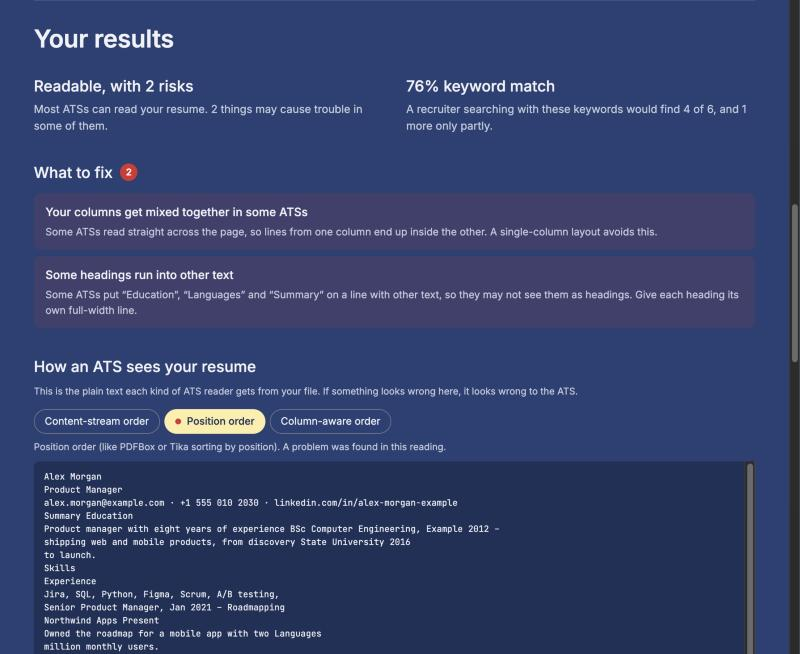

# resume-xray

See your resume the way an applicant tracking system (ATS) reads it.

Upload a PDF or DOCX resume and you get two answers: can an ATS read it, section by section, and
would a recruiter's keyword search find you. Everything runs on your computer.



> **Status:** early release (0.1). The readability checks have been tested on 33 real and
> template resumes (results below).

## Your resume stays on your computer

This was the first rule of the project, not an afterthought:

- **Nothing is uploaded.** The web page talks only to a small server on your own computer
  (`127.0.0.1`), which refuses requests from anywhere else.
- **Nothing is stored.** Your file is read in memory and forgotten after the analysis. No
  database, no log of your resume, no accounts.
- **The page cannot phone home.** A strict Content-Security-Policy forbids loading or sending
  anything to another address. Fonts, scripts and styles are part of the package; there is no CDN,
  no analytics and no telemetry. It works offline.
- **No AI model.** Results come from documented rules, so the same resume always gives the same
  report, and every result can be explained.

## Run it

You need Python 3.11 or newer ([python.org](https://www.python.org/downloads/)). On Windows, type `py`
instead of `python3`.

```bash
git clone https://github.com/alpakbaci/resume-xray.git
cd resume-xray
python3 -m venv .venv
source .venv/bin/activate        # Windows: .venv\Scripts\activate
pip install -e .
resume-xray
```

The last command opens the app in your browser. Next time, only the `source` and `resume-xray`
lines are needed.

1. Choose your resume (PDF or DOCX) and press **Analyze**.
2. Optionally paste a job ad, type your own keywords, or both.
3. Read **What to fix**, look at **How an ATS sees your resume**, and check the keywords.

The page is in English and Turkish.

### For developers: command line

The same analysis without the browser, for checking many files at once or feeding the JSON
report to another program.

```bash
resume-xray my_resume.pdf                     # can an ATS read it?
resume-xray my_resume.pdf --job job.txt       # ... and which keywords are missing
resume-xray my_resume.pdf --job job.txt --add "Scrum Master, SAP FI" --remove "English"
resume-xray my_resume.pdf --skills "Python, Docker, risk management"   # your own keywords only
resume-xray my_resume.pdf --raw               # the text each reader extracts
resume-xray my_resume.pdf --json              # machine-readable report
```

## How it works

**Three readers.** ATSs turn your file into plain text first, and different text extractors
read the same PDF differently. resume-xray reads every PDF three ways:

- in the order the text is stored in the file, modeled on Apache Tika and PDFBox with their default
  settings;
- top to bottom across the page by position;
- column by column.

DOCX files are read twice: all parts of the document (headers, text boxes, footers) and body
paragraphs only. When the readers disagree, you are told which kind of ATS is affected.

**Checks.** Each check looks for one known problem:

- no text layer (a scanned or image-only page);
- broken characters and split words;
- columns that get mixed together;
- text in headers, footers or text boxes;
- missing or non-standard section headings;
- missing email address and dates that can't be read;
- a LinkedIn address that is hidden behind a link or split over two lines;
- bullets that land on the wrong line.

The result is **Readable**, **Readable, with risks** or **Hard to read**. The worst problem
decides, so one serious problem is never averaged away.

**Keywords.** From a job ad, resume-xray takes the skills it knows (450 skills in 792 wordings,
English and Turkish, for software, data, AI, product, project, finance and marketing),
plus words that look technical such as `C++` or `ALLCAPS` names. Requirements count fully,
nice-to-haves less. General skills such as communication are shown but not counted, because
recruiters rarely search for them. The exact word counts fully; other word forms and synonyms
count half, because a plain search would miss them. You can add or remove keywords yourself, or skip the job
ad entirely.

**No single "ATS score".** No ATS publishes one, and blending readability and keywords into one
number would hide what to fix. Every rule, threshold and weight, with its reason and sources, is
in [ALGORITHM.md](ALGORITHM.md) ([Türkçe](ALGORITHM.tr.md)).

## How it was tested

Thresholds are measured, not guessed, and the results are reported as they came out.

**Synthetic set.** 23 resumes of invented people, each showing one layout or problem: two
columns, sidebars, tables, text boxes, letter-spaced headings, a scanned page, Turkish text and
more. They are made with real tools (printed by Chrome like web resume builders, exported by
Microsoft Word) so they carry real-world quirks. Each has a label of what is true about it, and
`pytest` checks every one. See [tests/fixtures/README.md](tests/fixtures/README.md).

**Blind tests on real resumes.** Real and template resumes from Canva, Overleaf, Google Docs,
LinkedIn and job sites, kept private and never committed. A labeling tool
([tools/label.py](tools/label.py)) shows each resume next to questions anyone can answer by
looking at it: Can you copy the text? One column or two? Which section headings are there? Is
the email address visible? It never shows resume-xray's results, so every label is written
before the tool's answer is known. Then the two are compared.

| Round | Resumes | Agreement before any change | After fixes (no longer blind) |
|---|---|---|---|
| 1 | 22 (11 Turkish) | 164 of 204 expectations (80%) | 22 of 22 resumes agree fully |
| 2 | 11 new (8 Turkish) | 83 of 97 expectations (86%) | 84 of 88 (95%), after one wrong label was corrected |

Disagreements are not always the tool's fault. In round 2, one "resume" was a single image that
looked selectable only because macOS Preview reads text in pictures (Live Text); the tool was
right, so the label was corrected and the labeling question now warns about it. Each
disagreement and fix is listed in the calibration table of [ALGORITHM.md](ALGORITHM.md).

## What it does not tell you

It does not predict whether you will be hired, and it does not reproduce any vendor's score.
Every ATS uses its own extractor and settings. resume-xray reads your file the way common
extractors do and shows where they disagree; a clean result means those readers read your
resume correctly.

## Contributing

Run the tests with `pip install -e ".[dev]"` and `pytest`. Dependencies must be MIT, BSD or
Apache-2.0 licensed, and every value the checks use lives in
[resume_xray/config/weights.toml](resume_xray/config/weights.toml), explained in
[ALGORITHM.md](ALGORITHM.md).

## License

[MIT](LICENSE). Third-party components and their licenses are listed in
[THIRD_PARTY_LICENSES.md](THIRD_PARTY_LICENSES.md).
